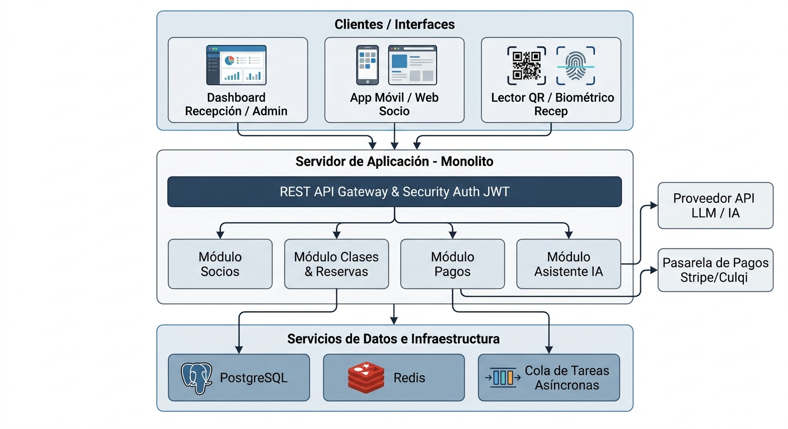

# 01. Arquitectura Inicial del Sistema

## 1. Visión General de la Arquitectura
La **Arquitectura Inicial** del **Sistema de Gestión de Gimnasio** ha sido concebida para brindar una solución centralizada, de alto rendimiento y fácil mantenimiento. El objetivo principal es respaldar las operaciones cotidianas del gimnasio (registro de socios, control de membresías, reserva de clases grupales y pagos) integrando capacidades avanzadas como asistencia mediante Inteligencia Artificial y consultas de cupos en tiempo real.

---

## 2. Diagrama de Arquitectura Inicial (Alto Nivel)

