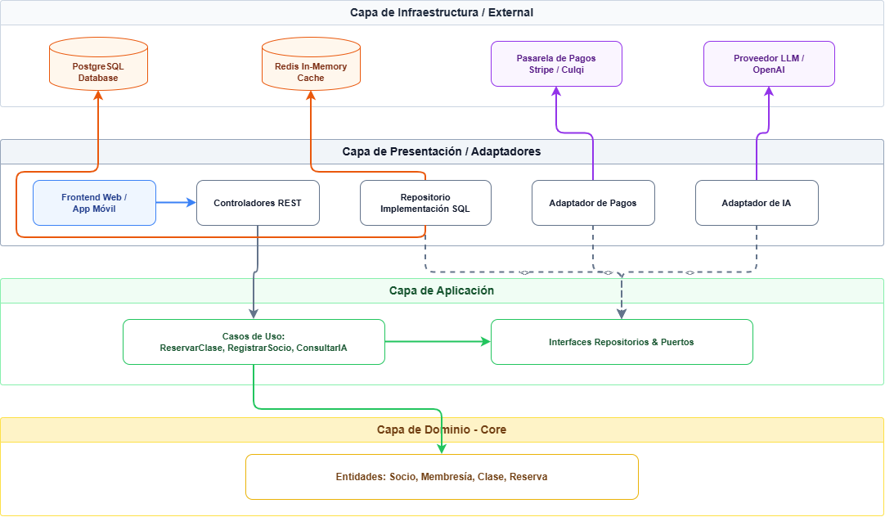

# 04. Enfoque Arquitectónico: Clean Architecture (Arquitectura Limpia)

## 1. Ficha Técnica y Descripción Aplicada
* **Patrón / Enfoque:** Clean Architecture (Robert C. Martin / Uncle Bob) (`ADR-002`)[cite: 4, 7, 8].
* **Objetivo:** Proteger el núcleo de las reglas de negocio del gimnasio (control de membresías vencidas, reglas de reserva de cupos, cálculo de aforo) aislándolo de frameworks, interfaces de usuario, bases de datos y servicios de terceros[cite: 4, 8].
* **Regla de Dependencia:** Las dependencias del código siempre deben apuntar hacia adentro (hacia la capa de Dominio)[cite: 4]. El centro no conoce nada de los detalles externos[cite: 4].

---

## 2. Definición Detallada de Capas

1. **Capa de Dominio (Domain Layer):**
   * **Componentes:** Entidades del gimnasio (`Socio`, `Membresia`, `Clase`, `Reserva`, `Pago`) y objetos de valor (*Value Objects*)[cite: 4].
   * **Reglas:** Contiene la lógica del negocio pura (ej. *impedir reserva si la membresía está vencida, congelada o el cupo de la sala está lleno*)[cite: 4]. Es 100% independiente de cualquier librería externa o base de datos[cite: 4].

2. **Capa de Aplicación (Application Layer):**
   * **Componentes:** Casos de uso (`ReservarClaseUseCase`, `RegistrarSocioUseCase`, `ProcesarPagoUseCase`, `ConsultarAsistenteIAUseCase`)[cite: 4].
   * **Reglas:** Define los flujos de interacción del sistema e interfaces/puertos (*Ports*) para repositorios y adaptadores externos[cite: 4].

3. **Capa de Presentación / Adaptadores (Interface Adapters):**
   * **Componentes:** Controladores REST (`Express/NestJS Controllers`), DTOs (*Data Transfer Objects*) y Serializadores[cite: 4].
   * **Reglas:** Transforma las peticiones HTTP/JSON recibidas desde los clientes Web/App Móvil hacia comandos ejecutables por los casos de uso[cite: 4].

4. **Capa de Infraestructura (Infrastructure Layer):**
   * **Componentes:** Implementaciones concretas de repositorios PostgreSQL, cliente de caché **Redis**, conector de colas asíncronas (**Workers**), adaptador de pasarela de pagos (**Stripe/Culqi**) y adaptador de la API externa de **IA (LLM)**[cite: 4].

---

## 3. Diagrama de Enfoque Clean Architecture (Sintaxis Mermaid)

