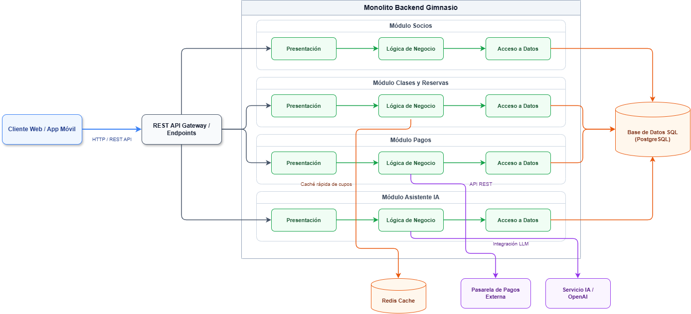

# 03. Estilo Arquitectónico: Monolito Modular en Capas

## 1. Descripción General
El **Sistema de Gestión de Gimnasio** adopta el estilo arquitectónico de **Monolito Modular con Organización Interna en Capas** (`ADR-001`)[cite: 4, 7]. 

Toda la aplicación backend se empaqueta y despliega como una única unidad ejecutable, pero internamente se encuentra estrictamente dividida en módulos de dominio totalmente independientes (`Socios`, `Clases y Reservas`, `Pagos`, `Asistente IA`)[cite: 4]. Cada módulo cuenta con su propia separación interna de responsabilidades en tres capas (Presentación, Lógica de Negocio y Acceso a Datos)[cite: 4, 8].

---

## 2. Justificación Arquitectónica (Drivers Atendidos)

* **DA01 - Escalabilidad / Rendimiento:** Permite un despliegue simplificado en etapas iniciales mientras mantiene fronteras claras por módulo[cite: 4]. La aceleración de consultas frecuentes (como disponibilidad de cupos en clases) se delega a una capa de caché en memoria (`Redis`) sin necesidad de fragmentar la aplicación en microservicios complejos[cite: 4, 7].
* **DA02 - Procesamiento Asíncrono (No Waitpoints):** Facilita procesar tareas pesadas (generación de reportes de ocupación y notificaciones de vencimiento) en segundo plano mediante colas de tareas[cite: 4, 7].
* **DA03 & DA04 - Seguridad e Integración Externa:** Centraliza la autenticación mediante tokens JWT y aísla la comunicación con servicios externos (Pasarela de Pagos y API de LLM / Asistente IA) mediante adaptadores[cite: 4, 7].
* **DA06 - Mantenibilidad y Evolución Modular:** Garantiza un bajo acoplamiento[cite: 4]. Es posible modificar, mejorar o añadir un módulo completo (por ejemplo, venta de suplementos o nutrición) sin afectar la estabilidad del núcleo de gestión de socios[cite: 4].

---

## 3. Ventajas y Desventajas del Estilo

### Ventajas:
1. **Despliegue Simplificado:** Un único artefacto ejecutable para desplegar y monitorear en producción[cite: 4, 8].
2. **Alta Mantenibilidad:** Fronteras claras entre dominios funcionales que evitan el "código espagueti"[cite: 4, 8].
3. **Evolución Futura a Microservicios:** Al estar desacoplado por módulos independientes, si en el futuro el módulo de *Clases y Reservas* sufre una carga masiva, se puede extraer fácilmente como un microservicio independiente[cite: 4, 8].
4. **Baja Latencia Inter-módulo:** Las llamadas entre módulos se realizan en memoria, evitando sobrecarga de red HTTP/gRPC[cite: 4].

### Desventajas y Mitigaciones:
1. **Escalamiento Monolítico:** Todo el sistema escala junto a nivel de infraestructura. *Mitigación:* Se añade memoria caché Redis para aliviar la carga de lectura de la base de datos SQL PostgreSQL[cite: 4, 7].
2. **Riesgo de Acoplamiento Indebido:** Si no se respetan las fronteras entre módulos. *Mitigación:* Estricta comunicación inter-módulo a través de interfaces bien definidas[cite: 4].

---

## 4. Diagrama Estructural (Sintaxis Mermaid)

