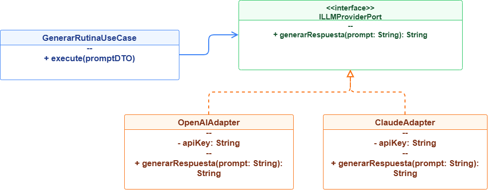

# 02. Patrones de Diseño (Design Patterns)

## 1. Visión General de Patrones
En la construcción del **Sistema de Gestión de Gimnasio**, los patrones de diseño GoF (*Gang of Four*) y patrones empresariales se emplean para resolver problemas recurrentes de creación, estructura y comportamiento de objetos[cite: 4]. Su implementación garantiza el desacoplamiento técnico y la adherencia a las decisiones de arquitectura (`ADR-001` a `ADR-005`)[cite: 7].

---

## 2. Matriz Consolidada de Patrones de Diseño

| Patrón | Categoría | Módulo / Componente | Justificación Técnica | Driver / ADR Relacionado |
| :--- | :--- | :--- | :--- | :--- |
| **Adapter (Adaptador)** | Estructural | Módulo Asistente IA & Módulo Pagos | Encapsula y estandariza la comunicación con APIs de terceros (OpenAI LLM, Pasarelas Culqi/Stripe). | `ADR-005`, `DA03` |
| **Repository (Repositorio)** | Estructural / DDD | Módulo Socios & Clases/Reservas | Aísla los casos de uso del mecanismo físico de persistencia (PostgreSQL/Redis). | `ADR-002`, `DA06` |
| **Factory Method** | Creacional | Módulo Pagos | Instancia dinámicamente el procesador de pago adecuado según la opción elegida por el socio. | `AC-05`, `DA06` |
| **Observer / Domain Events** | Comportamiento | Inter-Módulos (Pagos -> Socios) | Notifica eventos asíncronos (ej. `PagoCompletado`) entre módulos sin generar acoplamiento directo. | `ADR-004`, `DA02` |
| **Singleton** | Creacional | Capa de Infraestructura (DB & Redis) | Garantiza una única instancia compartida para la piscina de conexiones a PostgreSQL y cliente Redis. | `AC-01`, `DA01` |

---

## 3. Especificación Detallada de Implementación

### 3.1. Patrón Adapter (Estructural)
* **Problema:** Las APIs de LLM (OpenAI, Anthropic) o pasarelas de pago modifican frecuentemente sus firmas de métodos e interfaces.
* **Solución:** Definición de una interfaz propia (`ILLMProviderPort`) en la capa de aplicación. El adaptador concreto (`OpenAIAdapter`) implementa esta interfaz y traduce los objetos de dominio al formato nativo del proveedor externo.

