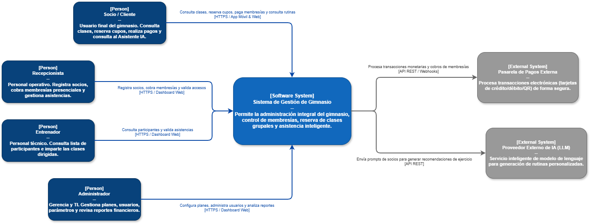

# 01. Modelo C4 - Nivel 1: Diagrama de Contexto del Sistema (System Context)

## 1. Visión General
El **Diagrama de Contexto del Sistema** muestra la posición del **Sistema de Gestión de Gimnasio** en su entorno operativo. Ilustra los usuarios (actores primarios) que interactúan con él y los sistemas/servicios externos con los que se integra para completar sus operaciones.

---

## 2. Diagrama de Contexto (Sintaxis C4 / Mermaid)

