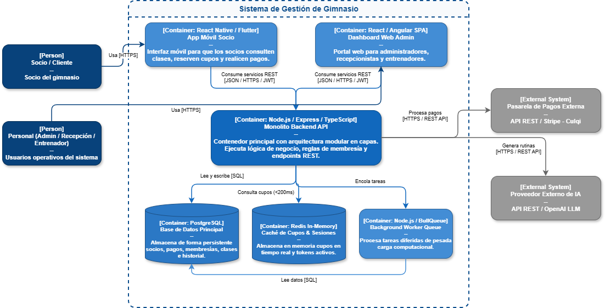

# 02. Modelo C4 - Nivel 2: Diagrama de Contenedores (Container Diagram)

## 1. Visión General
El **Diagrama de Contenedores** desacopla la caja azul del *Sistema de Gestión de Gimnasio* para mostrar las unidades de software ejecutables y de almacenamiento que componen la solución[cite: 1]. Define los límites tecnológicos, responsabilidades de cada contenedor y las decisiones de arquitectura adoptadas (`ADR-001` a `ADR-005`).

---

## 2. Diagrama de Contenedores (Sintaxis C4 / Mermaid)

