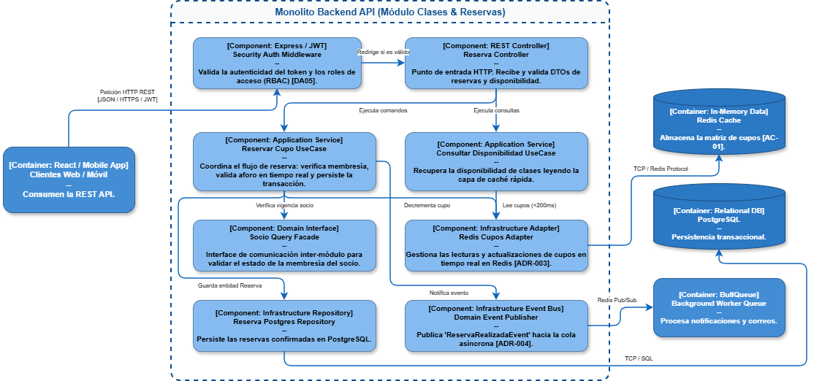

# 03. Modelo C4 - Nivel 3: Diagrama de Componentes (Component Diagram)

## 1. Visión General
El **Diagrama de Componentes** enfoca el interior del contenedor **Monolito Backend API**[cite: 1]. Para ilustrar la arquitectura interna bajo *Clean Architecture* (`ADR-002`), se toma como referencia central el **Módulo de Clases & Reservas**, mostrando sus componentes de presentación, aplicación, dominio e infraestructura, así como su conexión con los adaptadores compartidos.

---

## 2. Diagrama de Componentes (Sintaxis C4 / Mermaid)

