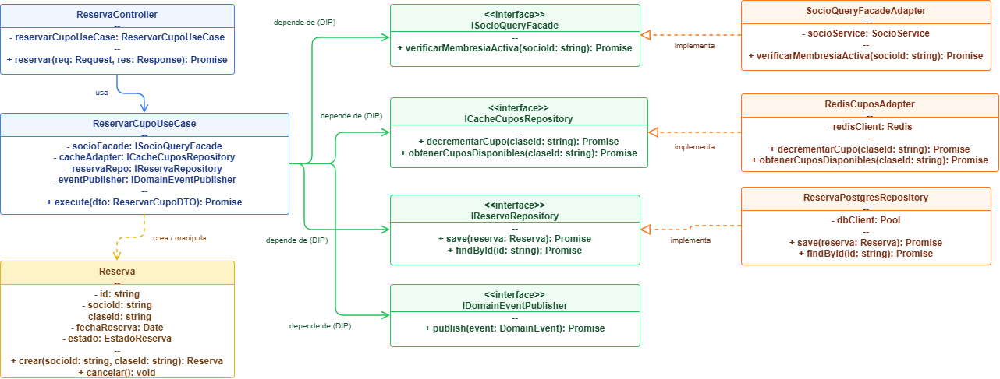

# 04. Modelo C4 - Nivel 4: Diagrama de Código (Code Diagram)

## 1. Visión General
El **Diagrama de Código** representa el nivel de mayor detalle técnico dentro del estándar **Modelo C4**[cite: 1]. Muestra cómo se implementan físicamente las clases, interfaces y patrones de diseño de *Clean Architecture* (`ADR-002`) en código TypeScript para resolver el caso de uso de **Reserva de Cupos y Notificación Asíncrona**.

---

## 2. Diagrama de Clases (UML / Mermaid)

